# JOV.si — Recovery Plan & Execution Roadmap

This dependency-ordered recovery plan executes the 17 milestones specified in the Master Execution Brief.

---

## Roadmap Overview

```mermaid
flowchart TD
    M0["M0: Recon, Inventory & Recovery Plan"] --> M1["M1: Strict Auth, Account Identity & Data Isolation"]
    M1 --> M2["M2: Configuration, Secrets Hygiene & LLM Provider"]
    M2 --> M3["M3: Zombie Code Removal & Mock Isolation"]
    M3 --> M4["M4: Master Resume Ingestion & Profile Verification"]
    M4 --> M5["M5: Source Registry & Real ATS Connectors"]
    M5 --> M6["M6: Normalized Schema, Geo Dataset & Location Parser"]
    M6 --> M7["M7: Search & Filters: Facets, URL State & UI Wiring"]
    M7 --> M8["M8: Feed Connectors & Restricted Board Fallbacks"]
    M8 --> M9["M9: Eligibility Gates & Explainable Scoring"]
    M9 --> M10["M10: Job-Specific Resume Tailoring & Grounding"]
    M10 --> M11["M11: Cover Letters with Fact Provenance Grounding"]
    M11 --> M12["M12: Application Planning & Manual Handoff"]
    M12 --> M13["M13: External Portal Authenticated-Session Workflow"]
    M13 --> M14["M14: Validation, Approval & Submission Pipeline"]
    M14 --> M15["M15: Dashboard & Settings Integration (Honest Greetings)"]
    M15 --> M16["M16: Security Hardening & SSRF Protections"]
    M16 --> M17["M17: Full Acceptance Run & Final Report"]
```

---

## Milestone Execution Matrix

### Milestone 1: Strict User Authentication, Account Identity & Data Isolation
- **Files to create/modify**:
  - `src/jovsi/adapters/db/models.py`: Add `UserDB`, `UserSessionDB`, `PasswordResetDB`, `EmailVerificationDB`; add `user_id` FK to `CandidateDB`.
  - `src/jovsi/services/auth.py`: Password hashing (PBKDF2/Argon2), session token management, rate limiting.
  - `src/jovsi/api/routers/auth.py`: `/register`, `/login`, `/logout`, `/me`, `/profile`, `/change-password`, `/forgot-password`, `/reset-password`, `/verify-email`.
  - `src/jovsi/api/dependencies.py`: `get_current_user`, `get_current_active_user`.
  - `src/jovsi/api/routers/candidates.py`, `applications.py`, `jobs.py`: Enforce ownership filtering.
  - `web/src/screens/AuthModal.tsx` or `AuthScreen.tsx`: Registration and login modal.
  - `web/src/api/client.ts`: Session handling, `/api/v1/auth/*` methods.
- **Tests**:
  - `tests/security/test_authentication.py`: Registration, login, session expiry, token revocation, rate limiting.
  - `tests/security/test_account_isolation.py`: Two-account isolation tests on candidates, facts, resumes, applications, documents.

### Milestone 2: Configuration, Secrets Hygiene, LLM Provider Abstraction
- **Files to create/modify**:
  - `.gitignore`: Add `.env*`, `.env.local`.
  - `.env.example`: Safe placeholder template.
  - `src/jovsi/services/llm.py`: `LLMProvider` interface, `GeminiLLMProvider` implementation with Pydantic structured output, exponential backoff, timeouts.
  - `src/jovsi/api/routers/health.py`: `/api/v1/health/llm` reporting provider, model, configured: true/false.
- **Tests**:
  - `tests/unit/test_llm_provider.py`: Provider mocking, retry logic, timeout handling, JSON-schema validation.
  - `tests/security/test_secret_leakage.py`: Fails build if secrets appear in tracked files or API responses.

### Milestone 3: Zombie-Code Removal & Mock Isolation
- **Files to modify**:
  - Delete `web/src/components/Button.tsx`, `web/src/components/ui/CommandPalette.tsx`, `web/src/components/Navbar.tsx`, `web/src/components/Card.tsx`, `web/src/components/AmbientBackdrop.tsx`, `web/src/components/BrandLogo.tsx`.
  - Keep mock portal adapter strictly isolated to `mock_portal/` and test suites.
- **Verification**: Run `pytest -v` and `npm run build`.

### Milestone 4: Master Resume Ingestion & Profile Verification
- **Files to modify**:
  - Bind master resume ingestion strictly to authenticated `current_user.id`.
  - Display extracted facts as unverified `PROPOSED`; user confirms facts to `ACTIVE`.

### Milestone 5: Source Registry & Real ATS Connectors
- **Files to create/modify**:
  - `src/jovsi/adapters/db/models.py`: Add `JobSourceDB`.
  - `src/jovsi/services/source_registry.py`: ATS prober for Greenhouse, Lever, Ashby, SmartRecruiters.
  - `src/jovsi/api/routers/sources.py`: CRUD and probe endpoints for employer sources.

### Milestone 6: Normalized Schema, Geo Dataset & Location Parser
- **Files to create/modify**:
  - `src/jovsi/adapters/db/models.py`: Add `GeoCountryDB`, `GeoAdmin1DB`, `GeoCityDB`, `GeoAliasDB`, `JobLocationDB`.
  - `src/jovsi/services/geo.py`: Offline reference loader, location string parser (structured, regex, aliases), country/state/city resolver.

### Milestone 7: Search & Filters: Facets, URL State & UI Wiring
- **Files to create/modify**:
  - `src/jovsi/api/routers/jobs.py`: Add `/api/v1/jobs/facets/locations` returning exact counts matching query.
  - `web/src/screens/JobDiscoveryScreen.tsx`: Add Country/State/City multi-select filters, work mode filters, search URL state sync.

### Milestones 8-17
- Executed sequentially as detailed in Master Execution Brief: feeds (M8), scoring (M9), tailoring (M10), cover letters (M11), planning/handoff (M12-13), mock pipeline (M14), settings & honest greeting (M15), hardening (M16), acceptance & final report (M17).
